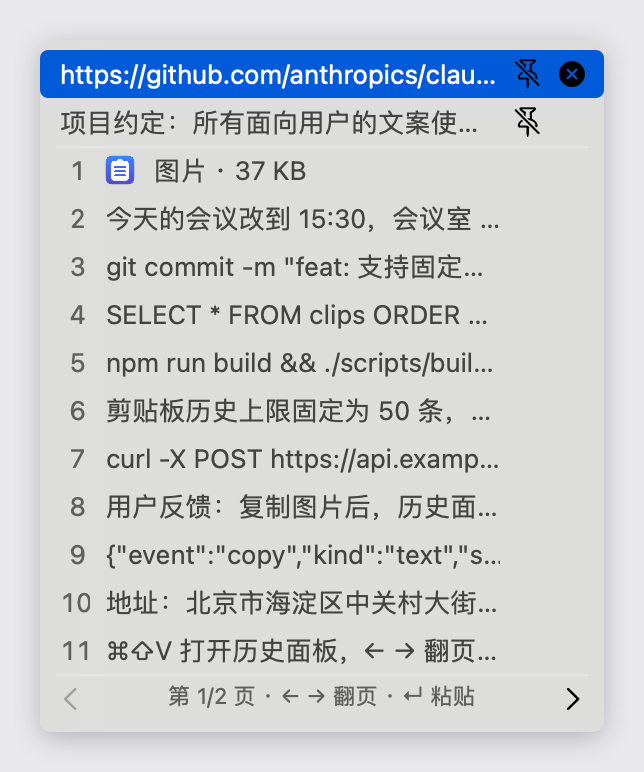
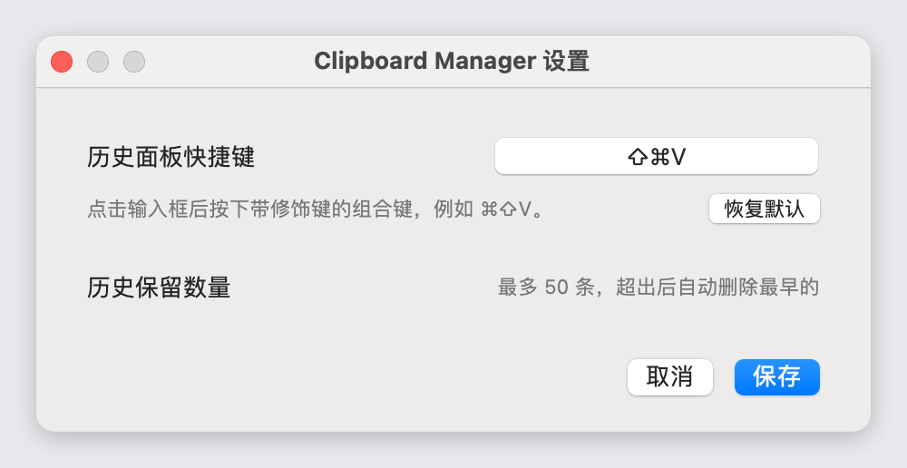

# Clipboard Manager

一款离线运行的 macOS 菜单栏剪贴板历史工具：后台记录复制的文本和图片，按 `⌘⇧V` 在光标处呼出历史面板，选中的条目会直接粘贴回当前应用。所有数据只保存在本机 SQLite，不登录、不联网。



## 功能

- **自动记录**：监听系统剪贴板，文本和图片都会保存；最近 50 条自动保留，超出后删除最早的条目。
- **快捷呼出**：默认 `⌘⇧V` 在鼠标位置弹出历史面板，快捷键可在设置中重新录制。
- **分页浏览**：面板每页最多 11 条、最多 3 页，`←` `→` 翻页，`↵` 粘贴高亮条目。
- **选中即粘贴**：点击条目或按回车，会把内容写回系统剪贴板，并自动粘贴到呼出面板前的应用。
- **固定条目**：条目悬停时出现图钉按钮，最多固定 5 条。固定内容置顶显示，且不计入 50 条的自动清理上限。
- **单条删除**：悬停条目后点击删除按钮即可移除该条。
- **完整历史**：状态栏菜单中的「显示历史」以滚动列表展示全部记录，包括分页面板之外的内容。
- **清空历史**：状态栏菜单 →「清空历史」，确认后删除所有记录（含固定条目）。
- **本地存储**：数据保存在 `~/Library/Application Support/ClipboardManager/history.sqlite3`。

## 使用

启动后，菜单栏会出现剪贴板图标：

1. 复制任意文本或图片，内容会自动出现在历史中。
2. 按 `⌘⇧V`（或点击状态栏图标 →「显示历史」）打开历史面板。
3. 点击条目即可粘贴；也可以用 `←` `→` 翻页、`↵` 粘贴当前高亮项。
4. 鼠标悬停在条目上可看到图钉与删除按钮。

### 设置



状态栏菜单 →「设置…」可以录制新的历史面板快捷键，或恢复默认的 `⌘⇧V`。历史保留数量固定为 50 条，超出后自动删除最早的未固定条目。

## 权限

全局快捷键和自动粘贴依赖「辅助功能」权限。首次启动时 macOS 会请求授权；如果快捷键没有反应，请到「系统设置 → 隐私与安全性 → 辅助功能」中确认 Clipboard Manager 已开启。

## 运行

工程使用 `swift-tools-version: 6.3`，需要对应的 Swift 工具链。

```bash
swift build --disable-sandbox
swift run --disable-sandbox ClipboardManagerApp
```

也可以构建可双击运行的菜单栏应用：

```bash
./scripts/build-app.sh
open "dist/Clipboard Manager.app"
```

`build-app.sh` 仅支持 Apple Silicon。

## 验证

```bash
swift test --disable-sandbox
```

## 当前范围

当前离线版不包含登录、云同步、运营后台和 Windows 客户端；这些方向记录在 `todo.md` 中。
